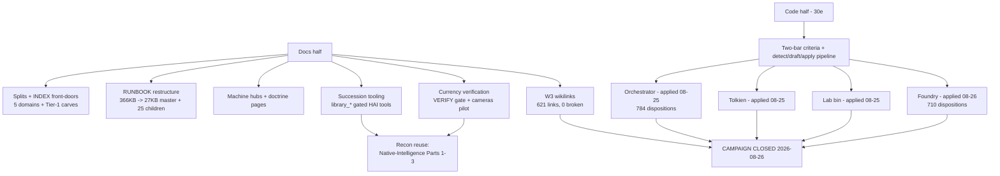
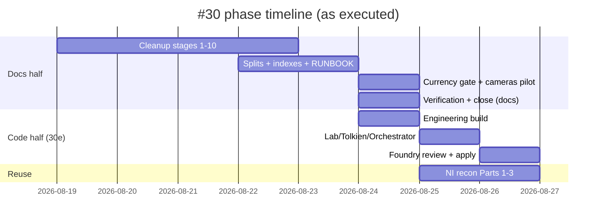

# 30-CAMPAIGN-CONCLUSION — Library Re-do, closed 2026-08-26

**Campaign #30 is CONCLUDED.** This is its conclusion report under the campaign convention
([[PROJECT-REGISTRY]] §Campaigns): what shipped, what was learned, what was disproven, and the
named residuals. It also consolidates #30's charter debt — the campaign ran on scattered plan docs
([[30d-OBSIDIAN-WIKI-RESTRUCTURE]], [[30e-CODE-NARRATIVE-CLEANUP]], tracker blocks), and this doc
is now the single front door to all of them.

## Why the campaign existed

HAI kept failing in ways that traced to a messy knowledge base: dangling narrative commentary,
stale claims served as current, documents too large to retrieve well, and no enforced currency.
the owner, 2026-08-24: *"we were working on HAI and trying to get it good… Then we found that issues it
was having stemmed from a messy library and all the dangling commentary."* #30 existed to fix the
library so HAI (#12) works — the campaign was always in service of the larger organism.

## Campaign map (as executed)

## What shipped

- **The library as a knowledge base:** domain splits with INDEX front-doors, the RUNBOOK
  restructure (thin operator master + 25 child pages), machine hubs, doctrine pages, and vault-wide
  `[[wikilinks]]` — 621 links, 0 broken, 186 docs, Archive excluded from resolution.
- **Currency as enforced policy:** `verify_gate` refuses restructures until claims are
  dispositioned; the cameras pilot proved the full loop through HAI; currency method codified in
  four retrievable homes (charter rule 10, rubric, method doc, 30d rule 8).
- **Succession tooling, HAI-drivable:** the gated `library_*` tool family (propose/apply split,
  carve, draft index, probe, check refs, apply restructure, apply wikilinks) — a future
  consolidation does not need a Claude session.
- **The code half:** the same two-bar cleanup applied to ALL FOUR code mirrors — Lab `c481924`,
  Tolkien `47b8ccd`, Orchestrator `8301b23` (784 dispositions), Foundry `15d9eed` (710
  dispositions, 2026-08-26) — each applied through the detect→draft→review→AST-gated-apply
  pipeline, suites green, deployed to every consumer, running code verified post-deploy.
- **Reused machinery:** the triage/extract/review pattern built for the docs half ran the
  Native-Intelligence reconnaissance (Campaign #35's foundation) — the campaign's tooling outlived
  its own scope, which is the point.

## What was learned (the durable lessons)

1. **A green model draft is not an applyable draft.** The foundry apply's AST gate caught 13
   malformed drafts *inside the human-accepted 684* (stray braces, missing docstring quotes,
   dropped `r`-prefixes on path-bearing strings, one comment rewrite that swallowed the next code
   line). Eyeball review catches judgment errors; only a parse/AST gate catches formatting ones.
   Both are required, neither substitutes.
2. **Byte-exact span matching + fresh re-scan makes drift safe.** Drafts drawn 08-25 applied 08-26
   over files that had changed (queue-litter fix, CRLF repairs): every drifted row surfaced as an
   explicit refusal, was re-anchored by hand against current text, and nothing misapplied silently.
3. **The two-bar criteria transfer from prose to code** — but MOVE must stay narrow: a narrative
   comment is what you *rewrite*, not what you relocate; relocate only when nothing binds the site
   (`triage_code` v2 prompt).
4. **Review at the margin is where the human belongs.** The 27B drafted 710/710; humans adjudicated
   26 rejects and 8 repeated failures. The 8 needed hand-authored text — and two independent Claude
   adjudications (08-25, 08-26) converged on the same judgments, including keeping doc-name
   authority citations on safety constants.
5. **Verification against reality beats verification against the packet.** One hand rewrite (0009)
   was corrected only because the live code was read: the file was a card-quiet gate, not the
   render path.

## What was disproven / negative results

- **"Line numbers identify a comment"** — false across even one day of drift; only (file, raw
  bytes) identity survives, and even that breaks on CRLF churn. Anchoring must always re-scan.
- **"An accepted draft can be spliced verbatim"** — false 13 times out of 684.
- **"The library can be restructured safely without a currency gate"** — the cameras domain
  disproved it (docs confidently describing a service removed weeks earlier); hence `verify_gate`.

## Residuals — RESOLVED TO ZERO UNREVIEWED (amended 2026-08-26 late night)

This section originally named 9 MOVE rows + 3 stragglers as open follow-up. the owner rejected that
close ("why would we say its done if there are residuals?"), so the campaign ran a same-night
burn-down instead. Final, verified state:

- **All MOVE rows resolved — no files-twice pass remains.** True campaign-wide MOVE debt was 38
  sites (a whole-tree audit found the 08-25 set was partial), plus a 9-site coding-runner pocket
  outside any earlier candidate set. Four fleet 27B orders (triage_code v2, "strip the story
  first") drafted them; Claude margin review ruled every row
  (`library-triage\s30-code-moverework-margin-review.json` — auditable, with why-lines); apply
  went through the standard gates (fresh-scan anchoring, AST, suites, predict-the-count) and
  deployed: orchestrator image + tolkien pair + coding-runner image rebuilt and Recreated on
  Sundae, foundry pushed to all three factories with running-code-postdates verification. Every
  drafted MOVE turned out to be knowledge **already durably filed** (roadmaps, design docs,
  journals), so its code site became a terse two-bar property line or a cut — filing twice was
  never needed.
- **The 3 stragglers** were adjudicated in the same margin review and applied with the rest.
- **Final whole-tree audit (378 files, 4 mirrors): 465 detector hits = 440 inside `_pre-sync-*`
  restore snapshots** (archives excluded from scope by the explicit 08-25 order-rejection
  decision) **+ 25 live hits, each an individually reviewed keep**: citation-class pointers to
  enforcing files (e.g. `tests/_no_live_probes.py` references), the stall daemon's own domain
  term "incident", the #35 recon extractors whose subject matter *is* the owner-attribution
  (`native_history_*` — the name is the data model, not a war story), load-bearing fixture dates
  (a test whose data really straddles a date boundary), and the detector describing itself.
- **The honest bar, recorded:** *zero UNREVIEWED narrative*, not zero detector hits — a
  high-recall scanner re-flags its own correct output, and silencing those keeps would damage
  load-bearing pointers.
- Pre-apply originals archived beside each mirror file as `*.preclean-s30-foundry-close-20260826`
  (main pass) and `*.preclean-s30-moverework-close-20260826` (burn-down); older mirror tiers in
  `Z:\Archives\code-mirrors-pre-30e-20260824`.

## Successors

- Library maintenance is now HAI's standing duty through the gated tools; no successor campaign
  needed for upkeep.
- Campaign #35 (Native Intelligence) inherits the review-campaign machinery; Campaign #12 resumes
  as the next active work.
