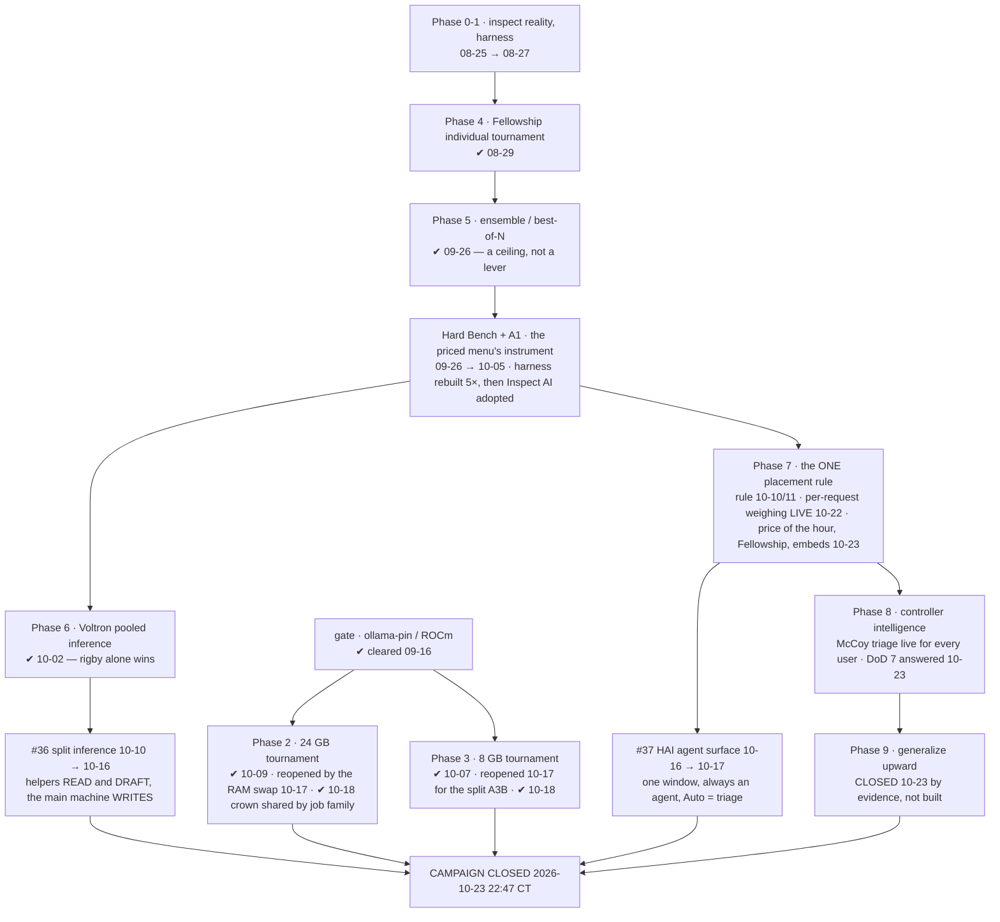
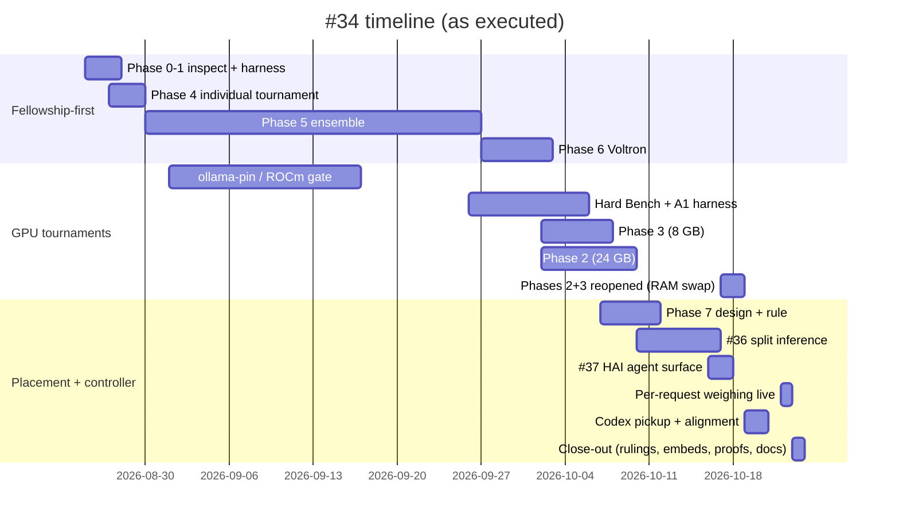

# 34-CAMPAIGN-CONCLUSION — Local Model Modernization + Fellowship Experimental Compute + Adaptive Orchestration, closed 2026-10-23

**Conclusion report** (registry convention: *"what shipped, what was learned, what was disproven. Negative results are
assets"*). Written 2026-10-23 night on Fable at the owner's word: *"let's do a post project summary, close out hypotheses,
after action report it and we'll be done."* The live state the campaign left is in [[34-Closeout]] (what runs, proven
through HAI's front door) and [[34-DECISIONS-AND-OPEN-ITEMS-REGISTER]] (every decision with its date and owner); this
document is the retrospective — the hypotheses the campaign set out with, each closed against what was measured, and the
after-action report. Scoped 2026-08-25 ([[34-CHARTER]]; source proposal verbatim in
`Archive\project-34-proposal-source-20260825\`), kicked off 2026-08-27, closed 2026-10-23 22:47 CT — **reopened 2026-10-24 for area C's last step, "the request's own needs", and closed again 09:50 CT once built and proven (§ Residuals, first row)** — at the owner's bar:
*"you are not allowed to close out 34 until you are 100% confident that we have 100% satisfied the charter and the design
doc and everything that I've said over the course of the project and intent."*

## Why the campaign existed

The lab had three GPU boxes, a tablet cluster and a reigning 27B, and no measured answer to the only question that
matters for a home lab paying for its own electricity: **which source of compute should answer this request?** The
proposal's central principle (§52) was the whole brief:

> Use the least expensive source of compute and intelligence that reliably satisfies a task's quality + time
> requirements, while accounting for verification, energy, resource contention, and escalation. … The architecture
> learns which strategy fits which task class — it does not assume one wins universally.

and its research question (§53): *for constrained local hardware, when is intelligence gained more efficiently by making
one model larger vs running more independent attempts? — and turn the answer into production scheduling policy, not an
academic number.* the owner sharpened the deliverable on 2026-10-02: the **priced menu** — every model shape × knob measured
per box (the boxes differ in hardware and power), so Kirk/Spock place each order by quality, time and real-world energy at
its urgency, and fall back to a slightly pricier box of similar quality when the best one is busy.

## Campaign map (as executed)

The window: 2026-08-25 → 2026-10-23, 60 days; 73 journal files in the window; a 1,785-line decisions register at the
close (its superseded blocks moved to `Archive\34-register-history-2026-10.md` and two in-flight snapshots); four
sibling archives for the charter, the close-out, the Phase 7 design and Terminal-Bench; Codex's pickup and alignment
passes (10-19/20) preserved under `Archive\p34-codex-*`.

## Hypotheses — closed out

Each hypothesis as the proposal, the charter or the owner stated it; the verdict is the measured one, with where the evidence
sits. **Supported · Refuted · Partly · Not tested** — "not tested" is written down so nobody mistakes it for answered.

| # | Hypothesis (source) | Verdict | Evidence |
|---|---|---|---|
| H1 | **§52 — the least expensive source that *reliably* satisfies quality + time wins; no strategy wins universally.** | **Supported, and it is now the production rule.** The intended design is **two layers** (the owner, 2026-10-24: *"from the VERY BEGINNING I've been describing it as a layered system"*): the request weighed for its needs — simple or hard, priority user, speed over depth, tools — then that need against the menu's matrix of cost (electricity, incl. price spikes), speed and quality, per user. **Layer two is built** (every row's three prices read per request; peak → energy first; extreme → hold); its resolution step is an ordered choice, not a weighted score — the two blended drafts misplaced in the replay. **Layer one is partial**: McCoy's triage asks tier, family and kind; priority user, speed-vs-depth and tools are not yet asked; per-user weighting and a price-triggered dump-and-resume are not built (§ Residuals). *(First draft of this row called the matrix "disproven" — wrong and unauthorised: the owner had ASKED "matrix or sequential gates?" on October 22 and my answer was filed as his ruling; corrected October 24.)* | [[34-Phase-7-Placement-Policy-Design]] § 3; the replay over the owner's 119 real requests (overflow as peers sent lead turns to a 0.68-quality row; line-before-quality dropped a cold lead to 8 GB) — `Datasets\Project34-Menu\real_requests_replay.md`. |
| H2 | **§53 — larger model vs more independent attempts.** | **Larger wins where it fits; more attempts only *look* like they help.** Best-of-N on the Hard Bench rose 0.61 → 0.94 (N 1 → 9) **only when the hidden checks picked the winner** — the verifier was the answer key; majority vote fell to 0.39. On the Phase 4 sets one tablet already reached the ceiling. At the top, the larger model (Flash-Next, A1 12/15 vs the 27B's 9/15, its solves a superset, ≈0.58 vs ≈0.94 MJ whole-box per solve) is also the cheaper one per *solve*. The production form of "more attempts" that survived is #36's: **helpers read and draft; one machine writes.** | [[34-Closeout]] DoD 4 + 1; [[36-Closeout]]; register § "Tournament decisions already made". |
| H3 | **§27 — "Coding may benefit strongly from the larger unified model."** | **Supported.** Phase 2 (8/9 + 3/7 hard), the A1 rematch, and the 8 GB tier's patient lane: `qwen3.8:27b` on BigHonker priced by speed only (~2 tok/s). | [[34-Closeout]] DoD 1/2. |
| H4 | **§27 — "Independent reasoning problems may benefit from ensemble attempts."** | **Refuted as a production lever** (H2); an ensemble is only as good as its selector, and the only selector that reached 0.94 was the hidden test. S10b (lead-written tests as the selector) is the surviving shape, accepted on three replicates; helper-piece assignment → #35. | [[34-Closeout]] DoD 4; register § E (S10). |
| H5 | **§27 — "Tool use may favor small specialized models."** | **Partly.** Within a tier it holds: the Fellowship's tool seat is Qwen2.5-1.5B (Phase 4); on BigHonker the split A3B's tool rows (93–94 %) sit beside `qwen3:8b` and Spock places per scenario. As a *cross-tier* preference it was not shown — the plain-English tool-using lead turn (six tool calls, 171 s) was placed on the lead by the weighing, and nothing measured a small model doing that job cheaper at acceptable quality. | [[34-Closeout]] DoD 2/3; the end-to-end run (journal 2026-10-23). |
| H6 | **§27 — "VLM may benefit substantially from larger models."** | **Partly — "substantially" was 3–9 quality points for two to six times the energy.** The dedicated VLM (`qwen3-vl:8b`) holds quality 1.0 on all three GPU boxes (Mothership 0.8 s / 239 J a solve; Softserve 1.4 s / 217 J; BigHonker 2.1 s / 250 J); the compact `minicpm-v:4.6` holds 0.96–0.97 at 96–112 J on the 8 GB boxes, and a text model reading the images (`qwen3.5:9b`, the two-image family) 0.91–0.94 at 37–58 J. The menu keeps every row that holds and the weighing picks by quality band, so the larger model wins only where the band demands it. On the Fellowship the larger VLM (Qwen2-VL-2B) took quality and SmolVLM2-500M the deployable seat. *(First draft of this row said nothing ran on the 24 GB tier — wrong; caught by reading the menu's rows before shipping.)* | `Datasets\Project34-Menu\policy.json` families `vlm`, `vlm-2x`; [[34-Closeout]] DoD 2/3. |
| H7 | **§27 — "Brainstorming / diagnosis may benefit from multiple diverse attempts."** | **Not tested.** No brainstorming or diagnosis set was ever built; the decomposition-advice question (C4) went to #35 data-blocked. Recorded here so it is not read as answered by H2. | register list B (C3/C4/C5). |
| H8 | **§28 — "three independent workers + deterministic verification" may outperform "one stronger worker", and the lesson generalizes upward to Starfleet.** | **Refuted in the stated form; the generalization happened anyway, in a different shape.** Deterministic verification was the hidden test (H2/H4) — on real work there is no such oracle. What generalized: the one placement rule is Starfleet's for chat AND orders, the Fellowship is priced on the same menu as the GPU boxes, and #36's read/draft/write split is the delegation shape. Phase 9 closed by evidence; external readers / drafters over the network are another project (the owner 10-23). | [[34-CHARTER]] § Research phase sequence; [[36-Closeout]]; register § E. |
| H9 | **§29 — "Do not assume static capability tiers" (Fellowship < BH < Mothership is not an intelligence ladder).** | **Supported.** The "8 GB = one worker" rule was not a physical limit (the split A3B runs on BigHonker, B10); rigby's GTX 1060 is the cheapest energy on the embed family with identical vectors; BigHonker's 27B is a patient lane, not a worse one; the tier that remained is a *quality band read from the menu*, not a box order. | register B10; [[34-Closeout]] "What is live"; the embed family rows. |
| H10 | **Addendum A — on roughly comparable Fellowship resources, several tiny models independently vs one larger model on pooled hardware.** | **Refuted for pooling:** rigby alone beats Voltron at every size rigby holds; the > 23 GB ceiling stays parked. | Phase 6 (10-02), [[34-Closeout]] DoD 5. |
| H11 | **Phase 8 premise — a tiny model improves a controller.** | **Supported where its confidence is calibrated on the controller's own question; refuted as a general classifier.** McCoy's family head read 63 % at the line (topic, not shape) and was dropped; as a triage he is sure for 21 of the owner's 119 real requests at the 0.90 line and right to hand the rest to the lead; the first call after a long idle pays ~2.5 s (the card waking), 0.19 s warm. The calibration question (is 0.90 the right line for real traffic?) is #35's with the data in the dataset. | [[34-Closeout]] § "C6 / DoD 7"; `real_requests_replay.md`; register § E baseline. |
| H12 | **The charter's instrument premise — benchmark numbers taken at a setting's *label* are the setting's value.** | **Refuted twice, and it changed the method.** Every "thinking on" qwen3.8 result before 10-07 ran at MEDIUM (ollama's renderer maps `think:true` → medium); every Mothership "xhigh" order after the 0.40.2 install (10-10) ran MEDIUM again until 10-16. A lock-vs-stock speed pair without a salt read +50 % that was +22 % (prompt cache). The campaign's numbers were re-run with the setting *proven* at the model, and the doctrine rows that make that automatic (effort audit, salted speed checks, `--cold`) shipped. | register § "EFFORT-LEVEL SANDBAG" + "#2"; doctrine rows 10-07 and 10-16. |

The charter's seven Definition-of-done questions are answered one by one in [[34-Closeout]] § "What #34 set out to do";
every one is ✅ with its date and the honest edges named (the real-traffic half of DoD 7 answered from a replay of the owner's
real requests, not from weeks of human Auto turns).

## What was learned (the durable lessons)

1. **Price per box, read all three prices per request, resolve in a measured order.** A single tradeable score inverted the
   chat order once (the headroom penalty put the Plex host above the failover) and two blended drafts misplaced in the
   replay (lead turns to a 0.68 row; a cold lead to 8 GB). Quality band → interactive line → home before overflow →
   energy → time holds on 119 real requests. This is layer two of the design; layer one (the request's own needs) is
   where the open items are.
2. **A selector is the whole value of an ensemble.** Without an oracle, more attempts buy nothing in production; with an
   oracle you have already solved the task. The surviving use of parallel small models is reading and drafting for one
   writer (#36).
3. **The instrument decides what you see.** Five harness rebuilds, two effort sandbags, a cached prompt and a reviewer
   that never saw the diff all produced confident wrong numbers. Count the rows that hit a limit; prove the setting at the
   model; salt or cold-load A/B arms; feed the reviewer the artifact; diff your prompts against the published protocol's
   source before the first run.
4. **Adopt the engine, write the order.** Aider's own benchmark and Inspect AI existed before the first hand-built
   harness; adopting them cost a day and ended the rebuild loop — and the part we kept (our own loop) was the part nobody
   maintained until the compaction gap bit (10-15).
5. **The menu must follow the hardware by itself.** Re-pricing from every delivery meant the RAM swap, the Fellowship's
   desk overhead and the embed family all entered the policy without a code change — and the Fellowship comes back on
   its own when desk time shrinks.
6. **Every unit of work on a box is visible or it is a blind spot.** `ollama_client.track`, the `live` claim,
   `yields_to_live`, the 12e doctrine class — the controller's own eval campaign ran invisibly through 66 GPU steps once;
   the fix is registration at the boundary the work crosses, never in the caller.
7. **One writer per component, one deploy door, one register.** Two sessions on one card, a hand `scp` to three boxes
   for four days, and a close written before the register's open list was empty were the campaign's organizational
   failures; the register (decisions with dates and owners, superseded blocks archived) is what made a 60-day,
   multi-session, multi-assistant campaign closable at all.
8. **the owner's standing corrections are design inputs**: *no routing labels from him*, *every user the same controls*,
   *McCoy is the singular exception* to no standing models, *quality is a price per factory*, *fill the menu, don't ask
   choices*, *don't sandbag the models*. Each is written where the next session lands (the do-not-collapse checklist).

## What was disproven / negative results

- Best-of-N and majority vote as production levers (Phase 5); swarm / Voltron over rigby alone (Phase 6).
- "8 GB = one worker" as a physical limit (the split A3B on BigHonker, B10).
- McCoy's family head as the menu's family (63 % — topic, not shape).
- Two blended drafts of the weighing (overflow rows as peers; the time line ahead of quality) — the replay is the proof.
  **Not** the matrix: the owner's two-layer design was never disproven (an earlier line here said so without his word; corrected October 24).
- "Thinking on" and "xhigh" results taken at their label (medium, twice).
- A lock-vs-stock speed pair without a salt (+50 % that was +22 %).
- The 8 GB cards as "slow" (a lost GPU; an occupied probe).
- The sub-agent tests of the wrong shape (blind, toolless, synchronous pieces — register 10-10).
- A warm Fellowship server for interactive chat (not needed: 8.5–9.1 s after the cross-cut fixes).
- Bulk embeds to the Fellowship as a built door (the per-order energy priced instead; desk time is the lever, handed on).

## After-action report

**What went well**

- The Fellowship-first order (0 → 1 → 4 → 5 → 6) produced the campaign's biggest negative results cheaply, on tablets,
  while the GPU tournaments waited on the ROCm gate — by the time the GPU boxes were measured, the ensemble and pooling
  questions were already closed.
- The register as the single decision surface: the owner could rule six open items in one sitting on 10-23 because each had
  its evidence, its options and its owner on one line; the close-out plan at its top turned *"I'd like to wrap this
  project up"* into a checklist.
- Measuring to the working end state: every live claim at the close was proven through HAI's front door with a
  ClaudeSupervisor chat the owner can open — and the proofs found and fixed five defects the same pass (a frozen "held it N s",
  a warm box priced cold, a results record overwriting its own delivery, the reranker's unreachable share path, a payload
  refusing its own tag).
- The menu followed the hardware (RAM swap, Fellowship, embeds) without being rebuilt.
- Doctrine was written at the class level as the mistakes happened — fourteen rows, each with the incident and the
  instrument that prevents it.

**What went wrong**

- **Instruments shipped before they were audited** — the harness rebuilt five times in two days; two effort sandbags
  that ran for weeks (the owner had flagged *"suspicious that the thinking off was doing better than the thinking on"* and was
  reassured twice); a reviewer fed 12 of 80 trail steps; a blind reranker path that waited 40 min on a share name the
  factory account cannot resolve. Each cost live GPU hours and a published number that had to be retracted.
- **Hand work where the lab had a door** — `scp` to three boxes for four days while Softserve ran the pre-fix harness;
  a hand `sed` on a gate pin; an embedding model copied into rigby's store by hand, which the filler then priced for an
  hour, DMing the owner every 15 min. The fixes were structural (the single deploy door and its police rule, the hold file),
  but each was found by the owner's phone or a drifted box, not by a check.
- **A collapse deployed** — 10-22's build folded the three-lens matrix into one axis and went live before the
  do-not-collapse checklist existed; rolled back the same day (`f8dbb08`). the owner, that day: *"a lot of those are just
  holdovers from HAI 1.0"* — the older mechanisms (the Force-27B gate, the hidden persona boxes) were never cross-cut
  when the rules changed in October.
- **A close written early** — the project was marked closed while § E still held six open items; the owner's bar (quoted
  at the top) reopened it, and the real close took one more evening of rulings, builds and proofs. The Fellowship was also
  nearly left off the embed family by my inference ("GPU rows only") until he asked.
- **A question of the owner's filed as his ruling.** October 22, 23:39: *"is it weighing them as a matrix or…like sequential
  gates?"* My answer ("gates") went into the register and journal as "the owner's read-back", then into two conclusion
  documents as "a weighted matrix — disproven". He caught it on October 24 (*"I never gave authorization to say it's
  'disproven'"*). Corrected in every copy the same hour; the doctrine row and the memory carry the tell: a question mark
  means the position is mine, not his.
- **A grep window read as a result (10-24).** `grep … | head -12` returned twelve other lines and not the `priority user`
  docstring, and I told the owner "nothing queues you ahead of other people" about B4a, live since the day before. The
  doctrine row for bounded windows already existed; this is its newest instance - count the matches before reading them.
- **A recreate without the lane (10-24).** The orchestrator recreate ran while `fleet_deploy` held the deploy lane for
  Tolkien; no collision, but the lane exists for exactly that, and the release step said so (rc 1).
- **Two unannounced factory updates** (Mothership 10-10 — the second effort sandbag; BigHonker 10-23) changed the
  measured object under the measurement → #38 lab update system.
- **Register sprawl**: 1,785 lines, with "IN FLIGHT" blocks written specifically so a compaction would not lose the
  state — it worked, but it is a symptom: the state lived in a document because no instrument held it.
- **The energy half ran on a placeholder** — HA's energy entities have read `unknown` since 09-25, so the peak / extreme
  price lines were never exercised live (unit pins only); the owner ruled them out of scope for #34.

**What we would do differently**

- Audit the instrument before the first live arm, every time: list every tool the model gets and what it returns that the
  grade reads; diff the prompt against the reference protocol; prove the effort at the model; salt the arms. (Now doctrine;
  it was learned at the cost of the Hard Bench's first two weeks.)
- Register the deploy door for every artefact type on day one (`fleet_deploy --workspace`, `--a1`, `--rigby-a1` all
  arrived after the hand copies).
- Keep the campaign's open list and its "closed" flag in one place with one writer, with "closed" mechanically downstream of the open list —
  closure was reported while § E still held six items.
- Measure the Fellowship on the same menu from the start rather than as the last thing priced; the reflex "GPU rows only"
  came from not having done so.

**Cost, honestly stated.** Sixty days wall time across four assistants' sessions (Fable, Opus, Codex, HAI as the worker);
no campaign-level kWh tally exists because the energy pipeline was down for the second half (residual below) — the
per-solve joules on the menu are the measured prices, the campaign's own consumption was not metered.

## Residuals — each with an owner, none unreviewed

| Item | Owner | Where |
|---|---|---|
| McCoy's 0.90 line on real traffic (calibration), placement-advice narrow door, decomposition advice, lab-trained decision model (C3/C4/C5) | **#35 Native Intelligence** | register list B + § E; `real_requests_replay.md` |
| Desk time / system time overheads (rigby desk 10.2 s, per-order server start 3.0 s, a tablet 28.6 s, Tolkien inbox pickup 15–229 s (inbox read every second since 2026-10-25, picked up inside the same second - [[Desk-Time-System-Time]]), the 3.8's cold load ~45 s, a new chat window ~9 s to first output, McCoy's first call after idle ~2.5 s) | **the follow-up mini project the owner named** (*"'desk time' or 'system time' etc is taking up a bunch of time"*) | register § E baseline |
| External readers / drafters over the network (Phase 9's build half) | another project, by ruling | register § E |
| The energy price pipeline (HA energy entities `unknown` since 09-25); the price LINES are set (2026-10-24: peak $0.12 = the utility's alert trigger, extreme $0.36 = p99 of 120 days — `Datasets\Project34-Menu\utility_psp_hourly.md`) and await their first live hour | register B10 (the pipeline); the lines done | [[34-Phase-7-Placement-Policy-Design]] § 6 |
| Qwen3 reranker (checked 4 of 4, ~0.9 s a rerank on CPU) | parked, PROJECT-BACKLOG | "#34 LEFTOVERS" |
| The menu filler prices any model file in rigby's store (skip embedding architectures) | PROJECT-BACKLOG "#34 LEFTOVERS" | |
| Sundae's root volume extension (43 GB VFree) + deploy-runbook cleanup step | handoff § 5 | [[34-Closeout]] "Handed off" |
| qwen3-vl:8b read-rate row on BigHonker | folds in at the next menu refresh after delivery | [[34-Closeout]] "Handed off" |
| Two unannounced factory updates | **#38 lab update system** | registry |
| The queue notice with two *human* users; the Fellowship's desk overhead on small n | refined by live use; named, not pretended | [[34-Closeout]] "Unverified at the close" |
| **Layer one of the two-layer design — BUILT 2026-10-24 (area C step 3):** McCoy's `depth` question on every turn, acted on at its measured line; per-user weighting was ALREADY live (B4a, 10-23 - my 09:xx claim that it was not was wrong) and is now in the record; the price pause at a job's hand-over point. **Still open:** the depth line is 0.90 with 0.80 the recorded candidate (`depth_replay_v2.md`); the price lines are set (10-24: $0.12 / $0.36) and the pause's first live hour is yet to come | #34 (done); #35 trains on the logged depth rows; the lines are the owner's | design § 6 step 8; register top block |
| H7 (brainstorming / diagnosis with diverse attempts) | **unowned** — recorded above so it is not mistaken for answered | this report |

## Successors

- **#35 Native Intelligence** — the judgment half: McCoy's calibration on real traffic, the narrow placement-advice door,
  decomposition advice, a lab-trained decision model; the data is `Datasets\Project34-Menu\`.
- **The desk-time project** (unnumbered at the close; the owner's words above) — every overhead in the table has a measured
  baseline here; the Fellowship's `j_order` falls by itself as they shrink.
- **#38 lab update system** — so the measured object stops changing under the measurement.
- **Network readers / drafters for Starfleet** — Phase 9's build half, another project by ruling.

*Related: [[34-CHARTER]] · [[34-Closeout]] · [[34-DECISIONS-AND-OPEN-ITEMS-REGISTER]] · [[34-Phase-7-Placement-Policy-Design]]
· [[34-Starfleet-Routing-and-HAI-Controls-Do-Not-Collapse-Checklist]] · [[36-Closeout]] · [[37-Closeout]] ·
[[30-CAMPAIGN-CONCLUSION]] (the sibling report this one follows).*
