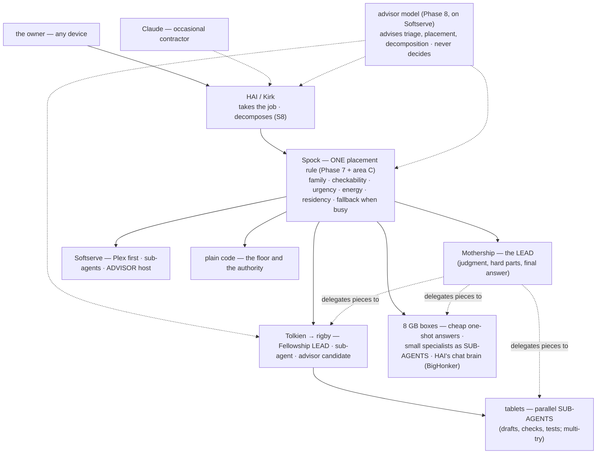
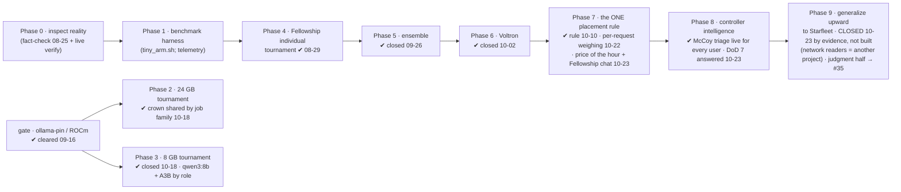
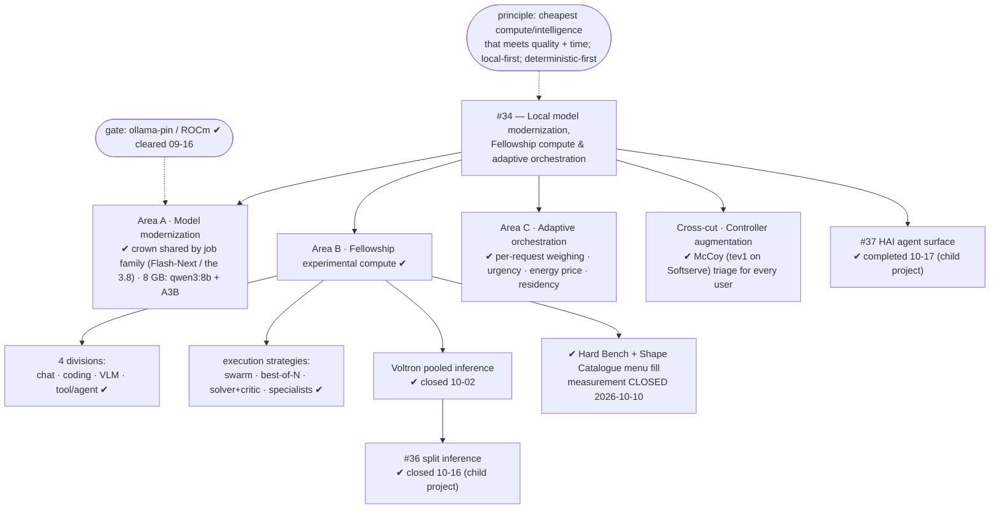

# #34 — Charter: Local Model Modernization + Fellowship Experimental Compute + Adaptive Orchestration

**Campaign charter** (registry convention — one per campaign; names members, phases, current phase,
gate). Registered SCOPED 2026-08-25 (PROJECT-BACKLOG §"PROJECT #34"); discharged at kickoff as
the area-B Fellowship tournament slice begins (2026-08-27, side session,
2026-08-27-claude-fellowship). Source proposal (2 docs) preserved verbatim in
`Archive\project-34-proposal-source-20260825\`; this charter is the navigable map, not a re-transcription. Conclusion report at the close: [[34-CAMPAIGN-CONCLUSION]].

## Central design principle (proposal §52)

> **Use the least expensive source of compute and intelligence that reliably satisfies a task's
> quality + time requirements, while accounting for verification, energy, resource contention, and
> escalation.** Sometimes that is ordinary code; sometimes one tiny model; sometimes seven tiny
> models; sometimes a 27B on the 7900 XTX; occasionally a larger, slower local model spilling to RAM.
> The architecture learns which strategy fits which task class — it does not assume one wins universally.

**The most interesting research question (§53):** for constrained local hardware, when is intelligence
gained more efficiently by making one model *larger* vs running more independent *attempts*? — and turn
the answer into production scheduling policy, not an academic number.

**The priced menu is the input to that policy (the owner, 2026-10-02):** every shape × knob is measured PER BOX (the
boxes differ in hardware and power) so Kirk/Spock can place each order by time and real-world energy cost at its
urgency, and fall back to a slightly pricier box of similar quality when the best one is busy. Arms stop being
filled only when they cannot fit or are priced out on their own box — the rule, with the owner's words, is in
[[34-Hard-Bench-Order-Spec]] § "When an arm stops being filled". **Mothership is the top end and is measured
differently (the owner 2026-10-02):** the champion `qwen3.8:27b` at every knob, helpers only where they beat it on price on
that box, and same-tier models it beats held there (so Area A's "every installed model priced" now reads: every model
on the 8 GB tier; the champion + price-winning helpers on the 24 GB tier) — [[34-Hard-Bench-Order-Spec]] § "Mothership is
the lab's top end".

## End state — what #34 serves (the lab after #34)

Synthesized 2026-10-04 from the owner's own words across the transcripts (2026-07-06 → 10-04), [[30f-DIVISION-OF-LABOR]]
(the North Star for who does what) and the Native Intelligence proposition
(`Archive\native-intelligence-proposal-source-20260826\`). Read this BEFORE deciding what to run next: every phase,
arm and cell below exists to serve this picture, and a test that tells us nothing about a component's ROLE in it is
grid-filling (the owner 2026-10-04: *"think about what exactly we're aiming for as the end state… we're not just blindly
testing models"*).

**Purpose (above #34).** *"THE LAB ITSELF IS THE AI"* (NI proposition, 08-26): Kirk, Spock, Tolkien/Fellowship, the
factories, models, tools, RAG, docs, memory, telemetry, deterministic routing and the hardware together are the
intelligence. One coherent system that grows with hardware — *"take any piece of hardware… add it to my system and then
my system is able to use it as a part of itself to make it more capable… more parallel arms"*, *"a magical smart house
from the future"* reached from any device (the owner 09-10); new hardware is tiered by measured horsepower (a Starfleet-level
name / its own subgroup / joins the Fellowship, 08-14). Ethos: *"I only deserve to run AI if I can figure out how to run
it on my hardware that I own"* (08-14) — local-first. Also the owner's playground for learning and fun (09-11). #34 is the
"orchestration modernizes the compute" leg of the Delegation epic (#12 → #34 → #35).

**How it works.** the owner talks to HAI from any device; the lab runs itself (*"end goal is that I can do all of this via
chat with hai"* 07-25; *"fully self reliant aside from when I… want it to reach out to you"* 08-15); the lab presents
findings, the owner directs and authorizes, Claude is an occasional outside contractor ([[30f-DIVISION-OF-LABOR]]).
**Everything is an ORDER**: chat, code and image requests all route through the orchestrator + scheduler (08-14); two
order layers — Starfleet command on top, the factory desks below, a desk directly when the owner says so (08-15/16); a whole
chain is one order (*"a training run with previews"*, 08-07) and the fleet works out the steps. HAI's real brain is the
orchestrator + scheduler on Softserve; BigHonker is the chat brain (07-26). The NI thesis lists HAI's judgments — what
the owner is actually trying to accomplish, conversation vs job, decomposition, which machine, whether latency / energy /
contention / urgency / human activity change it, when permission is needed: **#34 builds the machine half** (the priced
menu → Phase 7 placement → area C), **#35 trains the judgment half** into local models. Authority stays deterministic
and the owner's (consent and energy gates are his, 07-31; tools inform, they do not decide).

**Every layer has the same shape** — a lead splits work and hands pieces to ANY worker below it, each piece placed by the
one rule (cheapest ACCEPTABLE worker on the menu; § "How results shape action"):

**Roles, as the owner built them up (each step adds to the last):** rigby leading the 10 tablets *"similar shape to how I
frequently work with you… sub agents through your Claude interface… via HAI… orchestrated by Tolkien"* (09-28) → the
3.8 *"could spin up sub agents on the other boxes and tablets"* (10-03) → one shape at every layer (10-03). The 3.8 at
its full context leaves no room for sub-agents on the same card (09-29), which is WHY the smaller boxes matter: *"small
specialists that can fit on the 8gb and lower cards… so we don't always have to do a model swap on the 7900xtx for the
sub agents"* (10-04); specialists are Phase 7 sub-agents (10-04), **advisors to Tolkien and to Starfleet's Kirk and
Spock** (10-04), and priced on their real job (10-02). A sub-agent can also be the second reader — the assistant-manager
pattern (*"everybody needs an assistant sometimes"*, 08-12). Placement needs quality per box AND across the fleet
(*"Star fleet command need to know what they can fall back to with what caveats"*, 10-03) and may take a slightly
pricier box to get work done concurrently (10-02).

**The user-facing surface** — one chat window, always an agent, a live streaming transcript, triage + placement by
the advisor, the 3.8 as default lead (unsure ⇒ the 3.8), rigby and the tablets via Tolkien for simple turns, several
users at once — is designed in [[HAI-Agent-Surface-Design]] (2026-10-04) and BUILT by child project #37 ([[37-Closeout]], 10-17); the
advisor triages every user's Auto turn and Spock places it from the menu since 10-22/23.

**What this means for testing:** each component is tested in its ROLE — the lead in A1 / A1-team, the sub-agents and
specialists as helpers in A1-team / S10, the advisor on a controller-decision family (Phase 8), the placement rule in
Phase 7. Method evolved, additively: *"run every AI model on every tablet"* (08-30) was the TOURNAMENT method (Phase 4);
*"not doing unnecessary work that has obvious answers that we can extrapolate"* (10-03) and "test the role" (10-04)
govern the menu and role phase. **The crown is named at the END of #34, after A1** (10-04) — the 3.8 has been the
control since 09-29.

## How results shape action — acceptable quality per factory, judged on the box AND across the fleet (the owner, 2026-10-03)

Settled with the owner 2026-10-03 after a session collapsed the question to tablet pass rates. Read this before
proposing to stop, cull, or extend any part of the menu, on ANY box or worker.

1. **Why we measure.** The menu is there to produce *preliminary results that shape the project's next actions* —
   and to stop *"doing unnecessary work that has obvious answers that we can extrapolate to by using data that we
   have already collected."* Running every cell is not a goal in itself.
2. **Quality AND speed AND price, read at two levels at once.** On the arm's OWN box (its quality, time and energy
   there) **and across the fleet** — *"quality on that box AS WELL AS quality across the fleet. Since Star fleet
   command need to know what they can fall back to with what caveats."* "Better gained elsewhere" is a question the
   project itself is answering, and it is constrained by real hardware: *"I can't just spin up another instance of
   cloud based things … hence the whole project."*
3. **"Acceptable" is different per factory** — *"typically we will think in one-shots across the gpu fleets, but the
   tablets are special since we can run across the set and get multiple tries at once."*
   - **GPU fleet:** acceptable = the ONE-SHOT answer.
   - **Fellowship (tablets):** acceptable = what the set reaches over several attempts **with a selector production
     actually has** for that task (the task's own tests, a format/schema check, majority agreement, a checker). An
     answer key is not a selector: *"in real production it has to be able to … actually choose the correct one based
     off of whatever the task is, not just based off of the fact that we have an answer key."* A best-of-N scored by
     the key is a CEILING, never the arm's quality — already the rule since Phase 5 ([[34-Phase-5-Appraisal-Closeout]]
     "ORACLE upper bound"; [[34-Hard-Bench-Closeout]] "no selector"), restated here because it was forgotten.
   - **Sub-agent role — EVERY smaller worker, not only the tablets (the owner 2026-10-03):** *"if mothership is running the
     3.8 27b then perhaps it could spin up sub agents on the other boxes and tablets … how valuable the smaller boxes
     can be for sub agents."* The 8 GB boxes, rigby and the tablets can each serve the champion as sub-agents (drafts,
     candidates it checks, tests, parallel pieces). Usefulness as a helper is judged on its own, separately from
     answering alone, and an arm is not culled for failing alone. The design is S10 for rigby + tablets
     ([[34-S10-Rigby-Lead-Fellowship-Design]]), whose one line *"the same split applies one level up: Kirk + HAI's 27B
     (judgment) + the factories as sub-agents"* is this; the level-up version is not designed or measured yet. So a
     menu verdict like "the 8 GB tier cannot do W1 reliably" is a FINAL-ANSWER verdict only — though the menu still
     gives *"a good starting suggestion"* (the owner) for which helper does what.
   - **ONE shape at EVERY layer (the owner 2026-10-03):** *"we want this on multiple layers, not just the 3.8 as lead on
     mothership, but we also talked about Rigby doing a trial with the tablets as subagents. Basically it's the same
     shape across all layers. If 3.8 needs tablets then it uses tablets."* A lead (the 3.8 on Mothership, rigby, an 8 GB
     box, HAI/Kirk above them) splits its work and may use ANY worker below it — the 3.8 reaches the tablets directly,
     not through a fixed chain. **DOWN = any tier below, UP = the whole task (restated 2026-10-07, the owner, after it had
     collapsed to fixed one-helper team arms):** a lead at any layer — the 3.8 on Mothership, a 3070-class box, rigby —
     may hand pieces to ANY tier below it, each piece placed per piece by the one rule. **Two routers, one per level
     (the owner 2026-10-07):** Spock places on the FLEET — Mothership, the 8 GB boxes, or "the Fellowship" as ONE destination;
     everything bound for the Fellowship is an ORDER TO TOLKIEN, which places it on rigby or a tablet class (Tolkien is the
     Fellowship's smaller router and is taught the same way the Softserve advisor is). rigby is a Fellowship worker that
     happens to host Tolkien — never a fleet box a GPU lead targets directly. So: Mothership → the 8 GB boxes or the
     Fellowship (via Tolkien); an 8 GB lead → the Fellowship (via Tolkien); inside the Fellowship, rigby as lead → the
     tablets (Tolkien places). Delegation never goes sideways or up. **No MODEL picks routing (the owner 2026-10-07: "the
     models are not to be picking the routing, it's supposed to still go through Kirk and Spock at Starfleet command"):**
     the lead model's `delegate` only hands over a piece (with its family and urgency) as an ORDER to Kirk; Spock places it
     deterministically (the advisor on Softserve — **McCoy**, named by the owner 2026-10-07 — advises, never decides); a
     Fellowship-bound order is then placed by Tolkien. The same holds for escalation: the lead asks, Kirk/Spock move the
     whole task. When work needs a HIGHER tier, the ENTIRE task is passed up and the higher layer OWNS it from then
     on — never a piece sent up while the lower lead keeps ownership. The fixed `--team=<box>:<model>` A1-team arms are
     PRICING measurements (what each helper is worth, one variable); the production shape is the placed, any-tier-below
     delegate plus whole-task escalation. **So sub-agent value is not a study beside Phase 7 — it IS the Phase 7 policy applied to
     sub-tasks:** each piece is placed exactly as an order is (family, checkability, urgency, energy, residency → the
     cheapest ACCEPTABLE worker on the menu). One placement rule, applied recursively. It needs prices for sub-task
     shapes (W1's code / reasoning / ops parts per arm are the start) and the lead's own overhead (splitting, then
     reading helpers' results — rigby reads ~4 tok/s, the 3.8 is fast, so one split pays differently per lead).
4. **Low quality is a price.** An arm that is cheap per answer but not acceptable is not cheap: its cost per
   ACCEPTABLE answer is what §52 prices (*"reliably satisfies a task's quality + time requirements"*), and an answer
   *"that would've been better gained by running it in the mothership instead of the 3070 boxes"* is priced out by
   another name. This sits alongside the 10-02 ruling, it does not replace it: **dominated but acceptable = a fallback,
   kept with its caveat recorded; not acceptable (in its factory's mode, with no fallback or sub-agent value) = stop
   filling it**, once data already in hand supports the extrapolation. Small models are still measured in both
   directions — where a smaller model can replace a bigger one is half the question.

**Do not collapse:** per-box vs fleet · one-shot vs multi-attempt · final-answer vs sub-agent role · "dominated" vs
"unacceptable". **The pieces already exist:** the metric is the 10-02 menu reviews' **"per solved" — total wall or
board joules of ALL an arm's answers divided by the number solved, so failures are charged to the solves**
([[34-Softserve-Menu-Review-20261002]] § Summary); the line is the owner's **10× the box's cheapest cold solve**
([[34-Hard-Bench-Order-Spec]] § "Price ceilings"); the fleet side is the Phase 7 routing policy; the Fellowship's real
selector is S10b (lead-written tests). **Decided and live 2026-10-03 (the owner: "do the proper next steps"):** the
automatic stop rule ALSO prices the cost of a CORRECT answer, so a cheap but mostly-wrong arm is priced out
([[34-Hard-Bench-Order-Spec]] § "When an arm stops being filled", `menu_fill.PRICE_BASIS`). It covers the GPU arms the
filler prices, and rigby (one-shot like a GPU box; `menu_fill.rigby_stops`). The tablets are judged per class at the
menu rebuild — one-shot until a production selector exists (majority vote gains ≤ 1 task on C1/W1, measured
2026-10-03), instrument failures excluded, format failures reported apart.

## Hard constraints (do not violate)

- **Local-first (§2):** locally-owned, locally-executed open weights ONLY. No hosted/cloud models as
  lab workers, no local-CLI-to-remote, no ollama "cloud" variants. Claude/ChatGPT stay as external
  intelligence, not deployed workers. (This is why Ox Alpha was rejected.)
- **Deterministic-first (§7, §51):** do not replace reliable deterministic logic (Kirk/Spock/Tolkien
  cores, capability declarations, factory interfaces) with LLM calls just because AI exists. Preserve
  the working architecture; plug experiments into it.
- **Champion-until-beaten (§10):** a challenger must beat the reigning model in ACTUAL lab work, not benchmarks; do not
  assume newer = better. **The crown is SHARED BY JOB FAMILY since 2026-10-18** (Phase 2 re-closed): Flash-Next
  (qwen3.8-flash-next on Strata, Mothership) leads agentic / long-context work (A1 12/15 vs 9/15, less time and energy
  per solve; the owner: *"If there's an obvious winner let's stick with flash next as our preliminary winner"*); `qwen3.8:27b`
  keeps the quick families (equal or better quality, 2–4× faster, far less energy). History:
  `Archive\34-charter-history-2026-10.md`.

## Members (the four areas)

| area | what it is | status / gate |
|---|---|---|
| **A — Model modernization** | 24 GB champion tournament (challenge `qwen3.8:27b` — the control since 2026-09-29 — on the 7900 XTX; challengers installed ALONGSIDE, 3.8 stays control) + 8 GB tournament for the 3070/3070-Ti boxes (best model that exploits 8 GB — incl. MoE, aggressive quant, Nemotron-class agentic workers; NVIDIA-origin ≠ NVIDIA-only, §16) | **Gate CLEARED 2026-09-16** (Mothership on stock ollama 0.34.0, qwen3.8:27b resident; serving on **Vulkan since 2026-10-02**, was ROCm — [[34-A-OLLAMA-UPGRADE-GATE]]). **Phases 2 (24 GB) and 3 (8 GB) REOPENED 2026-10-03 (the owner: "Reopen baby")** — first marked closed the same evening,
then found that #34's own scope candidates (Gemma 3 27B, Nemotron 3 Nano 30B-A3B, Ornith-1.5-35B-A3B, MiniCPM5-1B /
MiniCPM-V 4.6; PROJECT-BACKLOG §#34) were never installed or run; they close when those have run. Standings so far,
from the GPU menu fill (the tournaments): every installed model on both tiers priced on coding / tool / vision / work (W1) / chat (C1), temperature, thinking and context, one grader reading answers as written (`Datasets\Project34-Menu\standings.md`). **24 GB: `qwen3.8:27b` champion, confirmed on the hard families** (W1 98% at 23 s/solve thinking-on, C1 100% at 8 s). **8 GB: `qwen3:8b` champion** (thinking-off coding ~1 s; thinking-on chat 79–83%), `qwen3.5:9b` thinking-off the cheap chat fallback (78–88% at 5–6 s), `qwen3-vl:8b` for tool/vision; not a reliable FINAL answerer on W1. Both are FINAL-ANSWER verdicts — sub-agent value is judged in Phase 7 (§ "How results shape action") |
| **B — Fellowship experimental compute** | per-class tiny-model tournaments + execution strategies + Voltron (below) | **DONE** — Phase 4 complete 08-29 · Phase 5 closed 09-26 · Phase 6 Voltron closed 10-02 (ceiling parked) · Hard Bench + [[34-Shape-Catalogue]] menu fill closed 10-10 · the Fellowship is a live placement destination (chat turns 8.5–9.1 s per order, chat titles, placed pieces) since 10-23 |
| **C — Adaptive orchestration** | EVOLVE existing `scheduler.place()`/`energy.py`/`capability.py` — add ETA, urgency/deadline, energy-in-placement, p95 distributions, opportunity/disruption cost, empirical feedback loop; reasoning-as-a-routable-resource (NONE/TINY_LOCAL/FELLOWSHIP/BH/MOTHERSHIP/ESCALATION, §9); ExecutionPlan metadata + factory telemetry (§35–37) | **BUILT on the existing `scheduler.place()`** — the per-request weighing (quality band → interactive line → home → J → time; area C step 1, 10-22), urgency from McCoy's kind, residency + re-read + the Fellowship's desk-order overhead as measured costs, the electricity price of the hour in every placement (step 2, 10-23), the table re-derived from every delivery (the empirical loop), the owner-first + overflow + the busy-pin queue. Not built: deadlines, p95 distributions, a completion ETA — PROPOSED for the backlog (no measurement called for them), not yet ruled by the owner |
| **X — Controller augmentation (advisory)** | tiny reasoning model as advisory to deterministic Tolkien/Kirk/Spock (ambiguity, decomposition, result-compare, escalation) → deterministic validation → execute/reject; candidate home = **rigby** (i7-3770 since 2026-08-28, low-frequency calls, §41). The GPU of §42 is the **GT 730** now in rigby (2 GB GDDR5, Kepler; 6.7 tok/s on a 1.5B, above every tablet; ~+30% throughput beside the CPU at ~3% cost to it — `Journal\2026-08-28-claude-fellowship.md`). **Advisor candidates, being priced on the menu from 2026-10-03:** Nemotron 3 Nano **4B** on Softserve for Kirk/Spock (the owner: *"an advisor that's lots of bang for very little buck (computer) on softserve"*; 2.8 GB, agentic-first, fits beside Plex) and MiniCPM5-1B (1.08B, built for tool calling) | **McCoy LIVE** — tev1 (a decision model) on Softserve (home moved from rigby, the owner 10-21), placed by Spock as kind `advisor`; triage ACTIVE for every user (10-23), 0.2–0.4 s a call, kept loaded (the single exception, the owner 10-23); DoD 7 answered. The machine half is built for Kirk and Spock, and for Tolkien as a shadow door (`/mccoy/tolkien`, 10-23); the judgment half beyond triage (placement, decomposition, Tolkien's advice, result comparison) is PROPOSED for #35, not yet ruled by the owner |

## Area B — the four competition divisions (§18–21)

Champions are found per division (a tiny model good at one may be poor at another):

- **Chat / Generalist** — reasoning, instruction adherence, context use, correction, hallucination ("Claude-but-tiny").
- **Coding** — executable tasks: tests passed, first-pass success, debugging, modifying existing code without breaking unrelated behavior.
- **VLM** — screenshots/UI, diagrams/charts, device screens, physical-lab observation (tablet cameras as sensors). Begin on the higher-RAM nodes.
- **Tool / Agent** — constrained job + fixed tool set: tool selection, argument correctness, schema compliance, recovery after failed calls, admitting uncertainty, latency. **Potentially the most valuable to Tolkien** — a model mediocre at chat but excellent at constrained tool use can still be a great worker.

Then **execution strategies** (§22–27): independent swarm · best-of-N · majority/consensus · solver+critic · solver+verifier · heterogeneous specialists; the 1/3/5/7-tablet scaling experiment (diminishing returns → spare tablets become specialists); **Voltron** pooled inference (can N tablets run one *smarter* model at a still-useful speed? — mechanism proven on Qwen2.5-7B, the serve-many bind is open). Prefer **deterministic verification** over an LLM judge wherever code can check the answer (§40). **⚠ The Phase 5 arms and concurrency rules were revisited 2026-09-04 after the roster grew from 7 → 11 tablets — see [[34-Phase-5-Ensemble-Design]]** (every-N ladder from 1 to 10 for swarm/best-of, odd-only for majority; team layouts run all four shapes; specialists tested at hardware-natural AND surprise-combo assignments; arms run in parallel by default with USB-segment mitigation for the wire-connected eight). The 1/3/5/7 language above is preserved for historical context; the Design doc is the authority for what Phase 5 actually runs.

## Evaluation methodology (judge on WORK, not benchmarks — §44–48)

Public benchmarks screen candidates; they do not pick winners (the owner's evidence: a better-benchmarking
model can be worse to collaborate with — Opus 5 vs Opus 4.8, §11). Every tournament includes:
- **Respect-existing-plans (§45):** given a plan, does it execute within it or needlessly redesign?
- **Correction (§46):** correct once — does it cleanly incorporate, or revert / get defensive / overcorrect?
- **Failure-recovery (§47):** a tool fails — investigate / change strategy, or repeat blindly / invent success?
- **Blind-reviewer limitation (§48):** don't penalize a model for context the orchestration failed to supply (Qwen3.6 needs context) — evaluate orchestration on context delivery too.

## Research phase sequence (§49) — Fellowship-first, because the GPU tournaments are gated

Phases 2/3 (GPU tournaments, area A) *were* gated on the ollama/ROCm decision (**gate CLEARED
2026-09-16** — see §Current phase & gate), which is why the earlier path ran Fellowship-first
(0 → 1 → 4 → 5 → 6 → 7) then controller (8) and generalization (9). Area C threads through as
telemetry/routing matures.

## Current phase & gate

**CLOSED 2026-10-23 22:47 CT; reopened and CLOSED AGAIN 2026-10-24 09:50 CT after area C's last step — "the request's own needs"** (register top block; design § 6 step 8; built, gated 3135 / 959, live on all four factories, proven through HAI's front door; the price lines set 13:10 CT the same day — peak $0.12 the utility's alert trigger, extreme $0.36 p99 of 120 days — so the price pause is armed, awaiting its first live hour). What it set out to build: (1) McCoy asks three more questions on every Auto turn — priority user, speed vs depth, tools needed — and CODE decides on them, as it does on tier; (2) per-user weighting in the busy queue (the owner's overrides put him ahead; every other user the same rules); (3) a price-triggered pause + quick-resume of in-flight work, reusing the slot's in-memory pause — area C's own words in the table above. Closes again when each proven through HAI's front door on a ClaudeSupervisor chat the owner can open, docs current, gate green on every factory — then #34 closes a second time, for good, and #35 opens with real data behind it. As of 10-23: every phase 0–9 is closed or answered (Phase 9 by evidence, not built — external readers / drafters over the network are another project, the owner 10-23) and DoD 1–7 are answered; the conclusion report is [[34-Closeout]]; the close-out plan, the owner's six rulings and every owed item are in [[34-DECISIONS-AND-OPEN-ITEMS-REGISTER]] § "CLOSE-OUT PLAN" E. The last pieces: the `embed` family on the menu (17:5x), the Qwen3 reranker checked and parked, the plain-English end-to-end run (a plain-English unpinned request went McCoy → Spock → the lead with six tool calls and answered with the live deck state in 171 s; five of the owner's real requests then ran live the same way), the doc pass. What #34 leaves: PROJECT-BACKLOG § "#34 LEFTOVERS" and the judgment half → #35. The phase history this section carried is in `Archive\34-charter-history-2026-10.md`.

### Where #34 stands against its Definition of done (step-back review, 2026-10-02 — the owner: "see where we are")

| # | DoD question (PROJECT-BACKLOG §#34) | status |
|---|---|---|
| 1 | Anything better than the reigning 27B; does 3.8 earn the seat? | ✅ **Phase 2 CLOSED 2026-10-09 — `qwen3.8:27b` at xhigh crowned** (lead-role test: 8/9 + 3/7 hard; Ornith 2/6 and Nemotron 0/6 early-stopped; challenger builds reviewed fair 2026-10-16: biggest quant that fits, max effort, vendor sampling). History: 3.8 crowned 09-29 and confirmed on the hard families 10-03 (W1 98 %, C1 100 %); Flash-Next challenged 10-02 (answers 4–1 better, 7× slower → 3.8 stays for live work); **the scope's other challengers (Gemma 3 27B, Nemotron 3 Nano, Ornith-1.5-35B-A3B) never ran — Phase 2 reopened 10-03 for them**; 3.8 served on Vulkan, 82 vs 54 tok/s |
| 2 | Best 8 GB model per box? | ✅ **Phase 3 CLOSED 2026-10-07 (the owner: "Yep sounds good")** — the reopened scope challengers (MiniCPM5-1B, MiniCPM-V 4.6, Nemotron 3 Nano 4B) were priced on BOTH 8 GB boxes and lost on merit; Nemotron 30B never fit 8 GB (a Phase 2 challenger). One Softserve refinement cell (qwen3.5:9b 2× vision) folds in when Plex allows; the 8 GB tier's SUB-AGENT price (A1-team) is Phase 7 input and its ADVISOR host role (McCoy) Phase 8. Standings (`Datasets\Project34-Menu\standings.md`, rebuilt under the one grader): **qwen3:8b** — thinking-off coding (90–93 %, ~1 s), thinking-on chat (C1 79–83 % at 12–16 s); **qwen3.5:9b thinking-off** the cheap chat fallback (C1 78–88 % at 5–6 s); qwen3-vl:8b for vision and tool. W1 as a final answer is "better gained" on Mothership (3.8 98 % at 23 s vs the 8 GB best 68–85 % at 33–110 s). **Sub-agent candidates (a suggestion, not a verdict):** qwen3.5:9b thinking-off for reasoning and diagnose-and-choose sub-steps (W1 reason 84 %, ops 97–100 %, seconds each); the 8 GB tier NOT for writing programs alone (W1 code 1–19 %) |
| 3 | Best Fellowship chat / coder / VLM / tool? | ✅ Phase 4 (08-29) |
| 4 | Does 3×/5× inference help; where do returns diminish? | ✅ Phase 5 (one tablet reaches the ceiling on easy sets); Hard Bench, harder tasks: best-of-N reaches 0.61 → 0.94 (N 1 → 9) **only when picked by the hidden checks — a ceiling, not production** (majority vote, the selector production has, falls 0.61 → 0.39); the production-real version needs a checker such as S10b's lead-written tests ([[34-S10-Rigby-Lead-Fellowship-Design]]) |
| 5 | Can pooled inference run a smarter model usefully; does swarm beat it? | ✅ Phase 6 closed 10-02 — rigby alone beats Voltron at every size rigby holds; the >23 GB ceiling stays parked. **New question REOPENED 2026-10-10 (the owner):** helpers that only READ and DRAFT while the main machine alone WRITES — [[36-Split-Inference-Helpers-Read-and-Draft-Design]] (rigby + tablets first, then Mothership + the lab; measurement first) |
| 6 | When should routing prefer Fellowship / BH / Mothership / plain code? | ✅ **ANSWERED 2026-10-11 (Track A closed)**; the rule is live and has placed every Auto turn since 2026-10-22/23 (McCoy's triage → Spock's per-request weighing; the family from McCoy's tier only, register close-out E). History: **STARTED 2026-10-07** — Phase 7 output (§53 scheduling policy): design + build steps in [[34-Phase-7-Placement-Policy-Design]] (menu → `policy.json` → Spock); A1 / sub-agent / advisor rows feed it as they land, they do not gate it. **10-10:** placed delegate + placed window live; residency is a measured placement cost; the lab regenerates `policy.json` itself (task "HAI P34 menu refresh"); the cascade arm (does the lead hand WHOLE W1 code tasks down to cheaper tiers?) is running. **Delegation has two shapes and only one is measured** (the owner 10-10: *"Cascade can mean things like sending a sub agent to read/find something for a main agent while the main stays doing something else… Fetch is perfectly normal. So is sending sub agents to run simple commands"*): whole-task escalation (the cascade arm) and the ERRAND — a helper with tools reads / finds / fetches / runs a command while the lead keeps working. Every A1 team arm so far was neither: a synchronous, toolless "write this function" piece. `lead_defaults.delegation` needs both ([[34-Phase-7-Placement-Policy-Design]] § "Two shapes of delegation"). **PHASE 7 CONCLUSION (2026-10-10):** the ONE placement rule is built, live and self-sustaining — priced menu → `policy.json` (regenerated by the lab every 15 min when its inputs change) → Spock orders the eligible hosts per job family × tier × lens, fills the model and settings from the row that placed the host, charges a cold model its measured load on the fastest lens; placed pieces and placed helper windows ride the same door. Routing finding, REPRODUCED 10-10 and in `policy.json` `lead_defaults.escalation`: HARD code starts at the lead (cheap tiers first, then up: 1.5–2.6× the lead's time and energy for the same solves; the lead's check-writing costs as much as solving). **Open, as its own measurement, not a gate on the rule:** what LEVEL the lead must be for agentic work, alone or with helpers below it, on time · quality · energy — the Terminal-Bench 2.0 lead-level grid (the owner 10-10: *"part of the project was trying to figure out at what level the lead has to be"*); the earlier team / sub-agent arms measured the wrong shape and decide nothing ([[34-A1-Agentic-Build-Family-Spec]] § "THE SUB-AGENT TESTS TO DATE MEASURED THE WRONG SHAPE"). **SOLO LEAD LEVEL ANSWERED 2026-10-11** (Terminal-Bench 2.0 spot set, 10 tasks, through the lab's relay + model-window orders): the 3.8 on Mothership leads agentic terminal work on all three lenses — 7/10, 5.5 min and 90 kJ per solve; the best 8 GB lead (Qwen3.5 9B) 5/10 at 31 min and 226 kJ per solve; Qwen3 8B 0/10, nemotron-3-nano:4b 1/10 ([[34-Terminal-Bench-Lead-Level-Grid-Plan]] § "SOLO VERDICT"). **DELEGATION DECIDED 2026-10-11:** offered errands to a Qwen3.5 9B helper, the 3.8 lead sent none in 10 tasks and scored the same 7/10 — `lead_defaults.delegation` = "the lead works alone" (in `policy.json`; plan § "ERRAND ARM RESULT"). **Q6 ANSWERED; Track A CLOSED 2026-10-11** |
| 7 | When does a tiny model improve a controller? | ✅ **ANSWERED 2026-10-23 from the measured rows — [[34-Closeout]] § "C6 / DoD 7":** where its confidence is calibrated on the controller's own question and code acts only above a threshold set on the lab's rows. Triage YES (tev1 ≥ 0.90: 10/10 on the owner's 36, deciding ~19–28 % in 0.18 s, 0 under-routes — McCoy, live); judging a worker PER FAMILY (W1 reason NO, W1 ops YES at 0.95); family-from-request NO (63 % at the line: topic, not shape). The real-traffic half is data-blocked and says so (0 human Auto turns since McCoy went active). |

**Status 2026-10-23 22:47 CT: CLOSED on the owner's word.** Every phase 0–9 is closed or answered and DoD 1–7 have answers (table above); his six rulings and every owed item are in [[34-DECISIONS-AND-OPEN-ITEMS-REGISTER]] § "CLOSE-OUT PLAN" E; the conclusion report is [[34-Closeout]].

## Campaign map

## Delegation-epic membership

#34 is the "orchestration modernizes the compute" leg of the Delegation epic (#12 → #34 → #35):
self-eng builds the mechanisms (#12), orchestration modernizes the compute they run on (#34), native
intelligence trains judgment into local models (#35). See [[PROJECT-REGISTRY]] §Epics.
