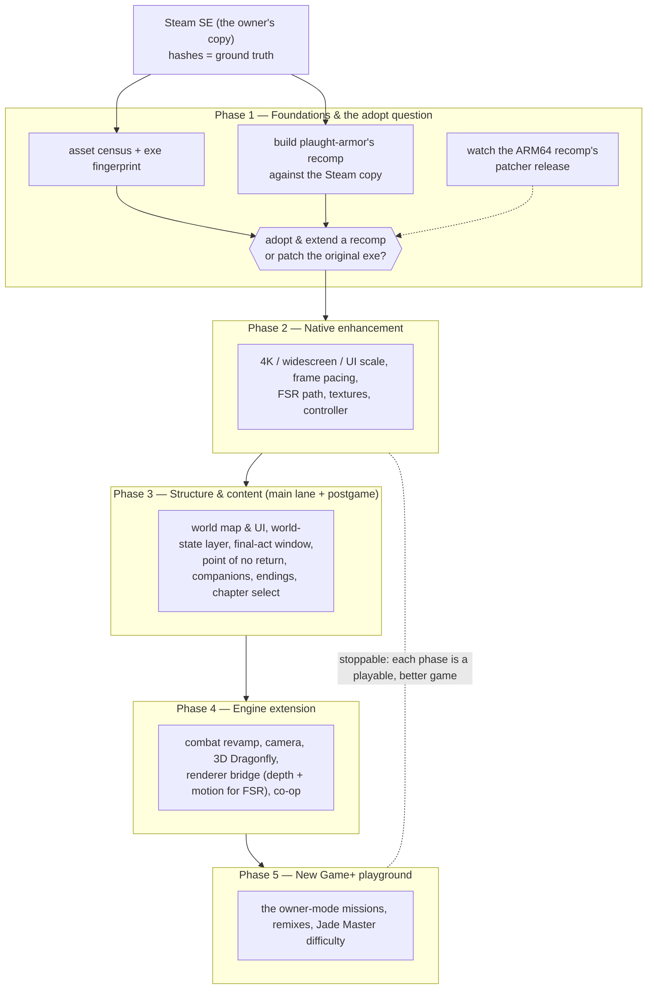
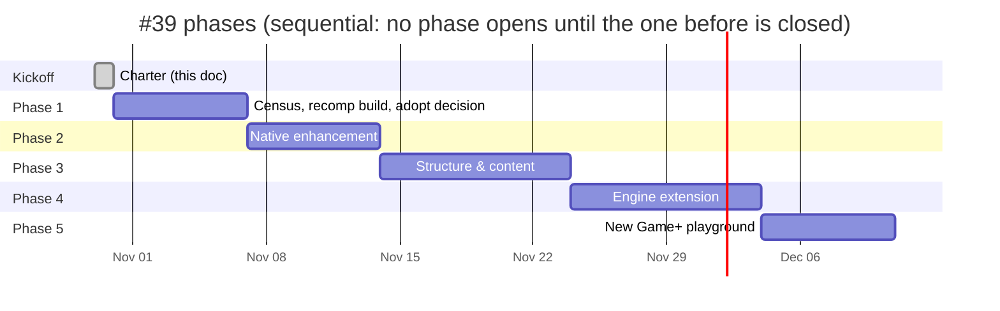

# #39 — Charter: Jade Empire, the owner Remake 1.0 (a private remaster-plus of the Steam Special Edition)

**Kicked off 2026-10-30** (the owner, after re-reading his ChatGPT design conversation: *"That sounds on track to me"*).
CAMPAIGN ([[PROJECT-REGISTRY]] § Campaigns). This is the one charter; scope history and research live in
PROJECT-BACKLOG § "CAMPAIGN #39" and [[Jade-Empire-39-Research-Pass-1-2026-10-29]].

**Sources, read as the owner's own intent:** the master packet
`Archive\jade-empire-remake-proposal-source-20261024\Jade_Empire_the owner_Remake_1.0_MASTER_PACKET_FINAL.md` and the full
design conversation beside it (`jade-empire-chatgpt-transcript-20261023.txt`; re-read 2026-10-30, all 45 of the owner's
turns). ChatGPT had no sight into the lab: every LAB fact in the packet is a claim to check; the design is the owner's.

## Why, and what done feels like (the owner's words)

- *"I friggin LOVE the game but my fiance says it's too old looking for her to get into."*
- *"I don't need it to look like it released today, just comfortable enough to feel modern and nice, and look good on
  our 4k tv."* Played from Mothership (7900 XTX) on the TV. *"This isn't a public release, this is for me at home."*
- *"Preserve the identity but update the flows."* Between a remaster and a remake: larger, more exposed environments
  (not open world), better skyboxes, a real 3D flying section (still mostly on rails), FSR.
- *"I'm not against remaking/patching and editing the engine, combat, or replacing models."* Combat: *"revamp it and
  remix it to what they envisioned at the time with a bit of flair"* (beat-em-ups he loves: Prototype, X-Men Legends,
  God of War, Spider-Man, Ninja Gaiden).
- Co-op is in scope (2026-10-29: *"Gosh I'd love coop"*).
- *"Ideally, I don't just become a total game dev. A little hobby project isn't bad."* Pictured as the lab running
  largely on its own for about a month, with occasional calls out to Claude, ChatGPT and the owner.

## Hard constraints (do not violate)

1. **Base = the owner's Steam Special Edition** (AppID 7110, build 251819). The local executable and resource hashes are
   ground truth (fingerprint taken 2026-10-30: 36,139 files, 7.31 GB, `JadeEmpire.exe` sha256 `0d25f18c…c54fe5`).
   Every other build (Xbox, GOG, mobile, the recomps) is comparative material.
2. **Private, one household.** Nothing built here is redistributed with game assets.
3. **No hand-assigned roles** (the owner, 2026-10-23: *"We want the lab itself to break it down and task out different
   agents and machines"*). This charter names WHAT and the gates, never which box or agent. Work goes through the desk as
   orders; a measurement or a build is an order with deliverables.
4. **Mothership is the owner's first.** Playtesting is the owner using his own machine; lab work on that box goes through the
   desk like any order.
5. **Identity first.** The main campaign stays recognisably Jade Empire; personal invention goes to New Game+.
6. **Stoppable at any layer.** Each phase must leave a playable, better game on its own.

## The three content lanes (the owner's decision, 2026-10-23 18:48)

| lane | what goes there |
|---|---|
| **Main campaign — faithful remake** | modernised flow and pacing, combat revamp (some of the new combat lives here, not only NG+ — the owner 18:50), world map and UI rebuilt, late-game free-roam window then an explicit point of no return, world reacting to what you did, companions present more (without rewriting the story), the final act given room, side content evolved (no checklist bloat), better endings and epilogues, chapter select |
| **Postgame — epilogue / world closure** | a modest postgame world and companion epilogues; more only if the owner later chooses a hobby phase |
| **New Game+ — the playground ("the owner mode")** | special missions, remixes, experiments, things that are fun even if not what the developers intended; Jade Master is a separate difficulty, not tied to NG+ |

Raised by ChatGPT after the packet and never answered by the owner (open, his call): environments with little to do in them;
silver with nothing worth buying; keeping the game's short length on purpose.

## Campaign map

## Phase timeline

Durations are placeholders, not commitments: they are re-set from Phase 1's measured evidence. The month the owner pictured is
the frame, not a deadline, and a hobby pace is acceptable.

## Phases, deliverables and gates

**Phase 1 — Foundations & the adopt question (CURRENT).**
- Asset census of the exact install (packet proof A) and the executable fingerprint (proof B, taken 2026-10-30).
- Build `github.com/plaught-armor/jade-empire-recomp` (GPL-3.0, Odin, SDL3 + OpenGL + FFmpeg; needs AVX2, which
  Mothership's 5800X has) against the Steam copy, unmodified, and record what actually works: rendering, frame rate, saves,
  controller, couch co-op, online co-op, and how much of the game is playable (the packet's static-recomp feasibility
  report, proof L, answered by a real build).
- Track u/Ok_Piece7346's ARM64 recomp: a patcher plus a DMG builder, announced as open source for "this week or next" on
  10-28, with a Linux port promised.

**What research already answers (2026-10-31, the owner: *"Half of that can probably be covered by research too"*).** Read
from the README and commit history (31 commits, 10-24 → 10-25, co-authored with Claude, 1 star, no releases, no issues
filed). These are DECLARED features, not yet seen running:
- Steam copy supported (Python 3 unpacks the protected exe); GOG too; EA/disc untried.
- Settings: frame rate (defaults to 30, raise by hand), render scale, anti-aliasing, sharpening, ambient occlusion, draw
  distance, shadows, fullscreen; stored in `JadeEmpire.ini` `[Port]`. Movies upscaled, with sharpening and vibrance.
- Controllers: Xbox, PlayStation, Switch, hot-swap. Saves stay in the game's `Save` folder.
- Co-op: couch (second controller, "Player 2's Hero") and online (UDP 47000, same commit and Odin build on both sides,
  Linux/Windows and Steam/GOG mixed). Online lobby is in the main menu.
- Windows build without Visual Studio (the installer fetches Odin, SDL3, FFmpeg).

So the build is a short check, not an investigation: build it, launch it on Mothership, and run a playtest list
(start a new game, load a save, a fight, a cutscene, raise the frame rate, couch co-op with two controllers).
- **Gate — the LAB's call on the evidence (the owner, 2026-10-31: *"I also don't really care if we start from a recompile or
  a fresh install"*):** adopt and extend a recompile as the base (the renderer becomes source, so FSR depth and motion
  vectors become ours to emit), or work on the original executable with mods and wrappers. the owner's direction that binds
  either way: FSR 4 gets baked into the game, which supersedes most base-game display fixes (*"half of that will be
  superseded by when we bake fsr 4 into the game"*). the owner's playtest comes when he feels like it; it does not block the
  build.
- **Kicked off 2026-10-31:** compute order `jade39-p1-recomp-build.20261031` (payload
  `workspace\jade39\build_recomp.py`, pinned to Mothership only because the game is installed there). It censuses the
  install, builds plaught-armor's recompile at commit `4d8459e` into the game folder with its own `install.bat`, unmodified,
  records what changed and `jade.exe --version`, and launches nothing. The build tree is kept at `F:\jade39\recomp\<commit>`
  on Mothership; deliverables ship to `\\<softserve-address>\SSDShared\jade39\phase1\<order>\`.
- **Result, 2026-10-31 13:22 — the recompile BUILDS on real Windows** (the README had only claimed Wine). All 5 steps
  ok: the stock exe was recognised (sha256 match), the installer unpacked the Steam exe to `JadeEmpire.unpacked.exe`,
  built in 76 s, and `jade.exe --version` answered `jade: build aadbdf1d2f5691aa (Windows, x86-64-v3), net protocol 13`.
  It added 11 files to the game folder (`jade.exe`, `play.bat`, `SDL3.dll`, five FFmpeg DLLs, two licence files, the
  unpacked exe) and changed none; `JadeEmpire.exe` is still stock. Not yet known: whether it RUNS (no window was
  opened; that is the first launch, the owner's or a later order's).
- **Census (same order, before the build):** 36,145 files, 7.31 GB (the 10-30 fingerprint's 36,139 plus the Steam fix,
  ini backup and the owner's saves). By size: 221 Bink movies 4.55 GB · 28,825 `.ogg` 1.13 GB · 1,028 `.rim` 1.0 GB ·
  63 `.mod` 335 MB · 805 loose `.txb` textures 144 MB · 3 `.bif` 72 MB. Most models, textures and areas sit inside the
  `.rim`/`.mod`/`.bif` archives, so a full model and texture count needs an archive reader (NeoERF, pass 1 §4).
  Full list: `census.csv` in the delivery folder.
- **Archive-level census, 2026-11-01 00:2x** (order `jade39-p1-asset-census.20261101`, payload
  `workspace\jade39\asset_census.py`, CPU only, 7.4 s). It parses the formats the recompile's own tools document
  (KEY V1 / BIFF V1 / RIM V1.0) plus the standard ERF V1.0 layout for `.mod`. **106,172 resources** in 3 BIFs,
  1,028 RIMs and 63 `.mod` (+ override). Positive controls:
  - unique textures **7,597 = the docs' 7,597** (exact);
  - type 3011 is 5,946 overall, of which the RIMs hold **exactly the docs' 5,516** (the docs counted RIMs only).

  Distinct resources:

  | Type | Distinct | Entries / size | Notes |
  |---|---|---|---|
  | mdl+mdx models | 3,580 | 8,323 entries, 336+316 MB | |
  | textures (tpc) | ~7,515 packed | 326 MB | 914 override files replace a packed resource |
  | scripts (ncs) | 8,947 | | |
  | dialogues | 520 | | |
  | creatures | 955 | | |
  | 2DA tables | 443 | | |
  | type 3028 (unidentified) | 15,093 | 39,407 entries, 314 MB, mostly in the `.mod` files | |
  | 2047 / 2057 / 2012 / 10 (unidentified) | small | | |

  The 39 `override/*.sav` are `SAV V3.2` (not ERF V1.0) and are listed as unparsed with that reason. **Named
  overnight** (HAI, checked against xoreos `src/aurora/types.h`): 3028 = BIP binary lipsync (the big unknown),
  3011 = MAB binary materials, 2047 = GUI, 2057 = SAV, 2012 = ARE, 10 = TXT. The `.sav` files are GFF V3.2 saves.
  See [[Jade-Empire-39-HAI-Night-Run-2026-11-01]].
- **FSR 4 runs on Mothership's card** (FSR SDK 2.4.0, Upscaling 4.1.2, 2026-10-28: *"requires an AMD Radeon RX 9000,
  RX 7000, RX 6000 Series discrete GPU"*, RX 7900 XTX on the Full INT8 model at 4K). An older FSR 4 page says
  RX 9000 only. Do not cite it. Full rows:
  `entries.csv` and `census_summary.json` in the delivery folder.
- **Research pass 2 handed to HAI (2026-10-31):** the recompile's renderer from its source, the routes for FSR 4 (OpenGL
  has no official FSR 4 path: interop, a Vulkan renderer, or DXVK on the original), and the model-tool leads. The
  first run was cut at 5 tool steps (fixed, `90efe2f`); the re-run's report, with Claude's reading of the recompile's
  source on top, is [[Jade-Empire-39-Research-Pass-2-2026-10-31]]. Headline: OpenGL 4.6 core renderer with a pre-UI
  post-process point, readable depth and the projection already captured; no motion vectors, jitter or sub-native
  scale yet; widescreen GUI already pillarboxed; a built-in control channel (`jectl`: keys, scripts, memory,
  screenshots) that lets the lab drive and check the game without the owner. Since the same day HAI's `fetch_url` reads public
  pages (`8ec9164`), so later passes can read the repo themselves.
- **First launch, 2026-10-31 15:57 — the recompile RUNS on real Windows on the 7900 XTX** (order
  `jade39-p1-recomp-launch.20261031`, payload `workspace\jade39\launch_probe.py`, driven over the port's own control
  channel from the owner's desktop session; nobody was at the desktop). `GL 4.6.0 Core Profile Context 26.10.1 on AMD Radeon
  RX 7900 XTX`; the channel opened in 1.4 s; it held the game's default 30 fps for a minute after a slow start (the
  first 60 frames took 27 s, cause not yet known); `quit` ended it cleanly, rc 0; the stock exe is unchanged.
  - **The FSR 4 bridge is DECLARED on this card:** Mothership's driver (OpenGL 26.10.1, Vulkan 1.4.359) lists all four
    OpenGL–Vulkan sharing extensions — `GL_EXT_memory_object`, `GL_EXT_memory_object_win32`, `GL_EXT_semaphore`,
    `GL_EXT_semaphore_win32` (304 GL extensions, positive controls present, real driver not the software one). That is
    declared, not proven: nothing has shared an image between the two APIs yet, which is the first Phase 2 bridge test.
  - **Display mode:** the port offers the game a fixed list of 60 Hz modes (`win32/user32.odin` `MODES`, 640x480 up to
    3840x2160, 4:3 and 16:9 only), so the ini's 3440x1440 @ 119 Hz matched nothing and it fell back to 640x480 (render
    scale 3, a 1280x960 window). The stock game needs 119 Hz on the ultrawide (no 60 Hz mode there) and the port needs a
    listed 60 Hz mode, and both read the same `JadeEmpire.ini`; adding the desktop's own mode to the port's list is a
    Phase 2 patch.
  - **The game writes the ini:** the run added a `[Controller (XBOX 360 For Windows)]` section (the port's scripted pads
    count as controllers). The ini was restored to its pre-launch bytes (backup `JadeEmpire.ini.bak-20261031-after-launch1`);
    the probe now restores it itself.
  - **It DRAWS BLACK on this card** (launches 1–4, same day). Every back-buffer read was 0% lit (nine shots across
    four runs: ESRB and title panels, the attract movie). An independent instrument agrees: launch 4's one FRESH grab
    of Mothership's screen (taskbar clock 4:08 PM) shows the "Jade Empire" window up, 0% lit, while the log says the
    attract movie is playing. Earlier desktop grabs were frozen frames (display asleep; the probe now checks each grab
    against the last), and PrintWindow returns junk for a GL window, so those prove nothing.
    - Ruled out, one variable each: **the post chain** (launch 4: SMAA, CAS sharpen, AO, bloom, soft particles,
      shadow maps, vibrance all off through the port's own `JE_` settings, still 0% lit); **MSAA** (the ini has
      `FSAA=0`, so no multisample resolve runs); **shader compile/link** (a failure is fatal in `glsl_compile`, and
      the game runs on).
    - Not a hardware difference: the developer's own docs cite a Radeon RX 7900 XTX (hle.md), so the gap is AMD's
      Windows OpenGL driver vs the Linux one the port was built on. The repo has no issues filed. And the card draws
      this game fine through its ORIGINAL renderer: the owner launched the stock `JadeEmpire.exe` directly on 2026-10-30
      and it rendered (that is how he saw the wonky ultrawide display). So the black is the recompile's OpenGL path.
    - **Next, built and waiting:** `jade-gldebug.exe` in the game folder (order `jade39-p1-gldebug-build.20261031`):
      the port's own `JE_GL_DEBUG=true` build, a glGetError check after every GL call, printing the failing call and
      source line. The launch probe groups those by error, call and place (`gl_errors`). Its launch
      (`jade39-p1-recomp-launch5-gldebug`) was REFUSED by the probe's own guard because someone had used Mothership's
      desktop 5 minutes earlier. Re-run as `launch6-gldebug` on the owner's go-ahead (`desktop_free=the owner`): VOID. The
      probe's GL check read `GDI Generic 1.1` (software) and `vulkaninfo` found no device, because an AMD driver
      package was installed on Mothership at 16:15 (System 7045, `amdkmdag.sys`) and the card has sat at
      `CM_PROB_FAILED_POST_START` since. The game then crashed on the missing GL 4.6 functions. Re-run the same spec
      once the card is back (a reboot most likely finishes the install).
    - **GL-debug launch, 2026-10-31 evening (`launch8-gldebug`, card back after the owner's power-off, driver
      26.10.2): ZERO GL errors.** It ran 76 s at 30 fps and quit rc 0. The wrapper was verified in the binary
      (`glGetError() returned` text present in `jade-gldebug.exe`, absent in `jade.exe`), so zero is a measurement.
      Every back-buffer pixel in every shot is exactly 0 (max 0, not dim), so not even the clear colour lands. The
      driver rejects nothing, yet nothing reaches the image. Also ruled out from source: the load-screen fade (it
      draws over a finished frame) and `null_render` (online co-op only).
    - **Research pass 3** ([[Jade-Empire-39-Research-Pass-3-2026-10-31]], HAI with the page reader, audited):
      ranked suspects in the renderer, led by `fb_bind` naming 4 draw buffers with three `GL_NONE`, then depth-only
      framebuffers and the program-pipeline copy. Each is a few-line patch to test with the build order and the
      probe's lit-pixel count. **The FSR 4 bridge has a real precedent:** AMD-Gfx-Drivers #76 ran exactly these four
      interop extensions on an RX 7900 XT, and AMD fixed its stall in Adrenalin 26.5.1 (Mothership: 26.10.2). For the
      census: xoreos-tools or the recompile's own `tools/rim`.
    - **Patches for the next test** (HAI night run, audited in [[Jade-Empire-39-HAI-Night-Run-2026-11-01]]):
      - patch 1 (only the live draw buffers in `fb_bind`) is ready;
      - patch 2 as written is broken and targets shadow maps, which launch 4 already ruled out;
      - patch 3 needs writing properly.

      Order: patch 1, then a plain-program Present copy, then the draw path. Launches wait on the owner (the card's
      recent watchdog resets).
    - **What would decide it** (not yet run): the same build on an NVIDIA Windows driver (BigHonker), one variable
      (driver vendor), which says whether this is AMD-specific; and a RenderDoc frame capture on Mothership, which
      shows where the draws land.

**Phase 2 — Native enhancement.** The game looks and feels good on the TV with what the chosen base supports: 4K and
widescreen, UI scale, steady frame pacing (the community stutter-fix `d3d9.dll` is a lead), the FSR route, texture work,
controller. **Gate:** the owner plays it on the TV and calls it comfortable.

**Phase 3 — Structure & content (main lane + postgame).** World map and UI rebuilt; a world-state layer
(plot state → area → NPC → dialogue → encounter → map); late-game free-roam window and explicit point of no return;
companions present more; endings and epilogues; chapter select (which doubles as a test harness); modest postgame.
Rule from the conversation: prototype a mechanic in script, play it, only then build it into the engine.

**Phase 4 — Engine extension.** Combat revamp (the beat-em-up flair, within Jade's identity), camera, the 3D Dragonfly
section (mostly on rails), the renderer bridge for FSR, co-op worked into companions, crowds and camera.

**Phase 5 — New Game+ playground.** the owner-mode content and the Jade Master difficulty.

**Close:** a short conclusion report (what shipped, what was learned, what was disproven), per the campaign convention.

## Tooling leads (from the conversation, not yet checked)

- `kmdlswap` (a 2026 KOTOR tool) reads Jade heads and bodies through a GPL "JadeBlender" reader: a modern model READER
  exists; a writer does not.
- REA (`morluto/rea`), cloned at `E:\SSDShared\third-party\rea` (since 10-19, not installed).
- `players.2da`'s fixed seven player rows: a known hardcoded limit, useful for checking that a tool really understands the
  executable.
- A Dawn Star epilogue that exists in the data but never shows because of a bug.
- Precedent for agent-driven work at whole-game scale: momo5502's 2026-10-09 write-up (agents + IDA MCP, a machine-checked
  harness with the original EXE as the oracle — the packet's §32).

## Current phase & gate

**PARKED 2026-11-01 by the owner** (*"Let's just put this down for now, I thought more of our work would be things other
than just launching the game"*). Pick up from here:
- the black-screen patch 1 test (one build + one launch, with the owner around);
- HAI can now keep its patches in `Z:\Workspace\hai-scratch\jade39\`;
- the adopt-or-patch gate is still open.

Lesson for the restart: lead with the non-launch work (research, census, planning, HAI jobs), and ask before any
thread that needs the game running.

**Non-launch work done 2026-11-01/02 (the owner hands-off; nothing ran the game).** Work in progress lives in
`Z:\Workspace\hai-scratch\jade39\` (git, commit `c228ae1`).
- **Patches, built:** `patches\` holds 00 diagnostic, 01 draw-buffer trim and 02 ultrawide mode (see its README).
  Order `jade39-p1-patch-build.20261101` compiled all three on Mothership as `jade-diag.exe`, `jade-p01.exe` and
  `jade-uw.exe` beside an untouched `jade.exe`. The next test is three short `jade-diag` launches (`JE_DIAG=tex`,
  `dsa`, `bind`), when the owner wants.
- **HAI: `fsr4-motion-vectors-design.md`** (run `840fb306…`, 789 turns, audited by Claude):
  - The scene shaders never get the projection: the vertex epilogue `d3d9_glsl.odin:373` is
    `gl_Position = vec4(opos.xy + opos.w * pos_fix.xy, opos.zw)`, with clip space built in the FFVS
    (`d3d9_ffvs.odin:124`, `wvp = wv · proj`). The only shader-side projection is `ssao_projection`
    (`d3d9_state.odin:166`).
  - So jitter is a one-term change to that epilogue, and camera motion vectors can reuse the SSAO path's inverse
    projection. `GLSL_COMMON` (`d3d9_glsl.odin:356/418`) is the single injection point.
  - The shadow system's per-draw matrix and CPU-skin records are the precedent for object motion.
  - `SkinSW` / software vertex processing is stored and never read.
  - FSR 4 is DX12/Vulkan DLLs only, so the GL→Vulkan bridge stays the route.
  - The render scale is an integer (`d3d9_res.odin:45`), so only Performance 2.0× and Ultra Performance 3.0× are
    reachable until it becomes fractional.
  - One citation in it is off (it gives `ffvs.odin:83–94` for the projection multiply; the real line is `:124`).
  - Its claim that `fetch_url` truncated pages is wrong. Claude checked each layer against the run's own tool log:
    the pages came back whole with their read-on footers (`rendering.md` in three pages = all 44,365 chars,
    `game_map.md` = all 24,824), and the loop passes results to the model unclipped (`ollama_client`: the tool
    message is the full `_rtext`, `run_tool` clips only its log line). HAI's "of 30,095" is `modding.md`'s length,
    and its 74,605 / 78,343 match no file. Corrected in its night log.
- **HAI: `content-map-v1.md`** + `tools\derive_pairs.py` (CSVs generated, not typed) + `test_reconcile.py` (12
  tests, green):
  - 50 modules grouped by chapter, with dialogue, creature, script, model and lipsync counts;
  - 920 dialogue entries come down to 520 unique trees;
  - the extraction plan: DLG is GFF, plus `dialog.tlk` and NCS. The recompile has no GFF/TLK reader; xoreos-tools
    `gff2xml` / `tlk2xml` do.
- **Lab gap found:** HAI cannot commit in `hai-scratch`. `coding_git` is read-only, and `coding_task` won't start
  with uncommitted changes, so checkpoints are unreachable once it has written a file. Claude committed this night's
  work by hand.

**Phase 1** is current, kicked off 2026-10-31. The recompile BUILDS and RUNS on Mothership (GL 4.6 core, 30 fps,
clean quit) but DRAWS BLACK on AMD's Windows OpenGL driver; the GL-debug build that should name the failing call is
built and its launch is waiting for a free desktop. The FSR 4 interop extensions are declared by the driver. The base
game has only the Steam launch fix and two `JadeEmpire.ini` settings (PROJECT-BACKLOG § #39). The gate is the
adopt-or-patch decision, the lab's, made on that evidence.
